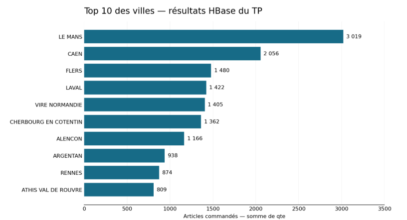
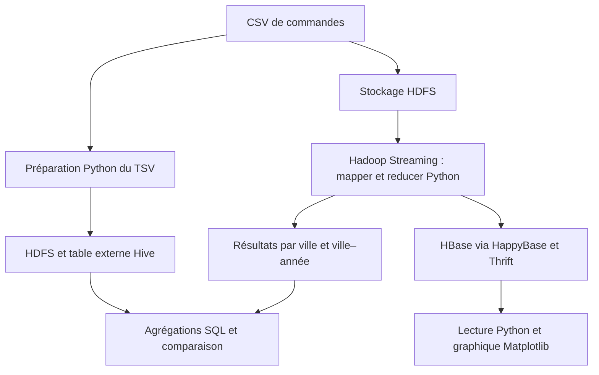

# Analyse des ventes par ville avec Hadoop

**TP individuel évalué réalisé dans le cadre de ma formation Ingénieur Data et IA.**

J’ai mis en œuvre des traitements Hadoop Streaming en Python pour agréger les quantités d’articles commandés, puis exploité les résultats avec HBase, HappyBase, Matplotlib et Hive. Le rapport documente les exécutions, les contrôles et la correction d’un classement erroné lié aux noms de villes contenant des espaces.

[Voir les preuves](docs/compte-rendu-TP.pdf) · [Examiner les scripts](src/) · [Lire les résultats](docs/resultats.md) · [Retour au portfolio](../../README.md)

## Résultats en un regard

| Élément observé                      | Résultat documenté        |
| ------------------------------------ | ------------------------- |
| Villes stockées dans HBase           | 6 255 clés                |
| Ville en tête du classement          | LE MANS : 3 019 articles  |
| Lignes de la table Hive              | 135 277                   |
| Comparaison MapReduce / HBase / Hive | Concordance des résultats |
| NiFi                                 | Non traité dans ce TP     |



_Graphique de présentation ajouté pour le portfolio : valeurs retranscrites de la capture HBase, sans recalcul depuis le fichier source._

## Besoin métier et règle de calcul

Identifier les villes et les couples ville–année cumulant le plus d’articles commandés. Une ligne représente un article associé à une commande : **le total correspond à la somme de `qte`, pas au nombre de lignes, au nombre de commandes ou au chiffre d’affaires.**

## Chaîne de traitement réalisée



Le cluster Docker est un environnement pédagogique comprenant un master et deux slaves. Les services sont lancés avec les scripts fournis par la formation. La branche Hive utilise un TSV préparé depuis la source CSV ; elle ne lit pas les agrégats HBase. NiFi ne fait pas partie du périmètre réalisé.

## Ma contribution

- Mise en route et contrôle de l’environnement Hadoop fourni : conteneurs, services et stockage HDFS.
- Analyse de la source et préparation d’un dictionnaire des données.
- Réalisation de mappers et reducers Python pour les agrégations par ville et par année.
- Tests locaux puis lancement des jobs Hadoop Streaming.
- Écriture des agrégats par ville dans HBase et contrôles via HBase Shell.
- Lecture de HBase avec HappyBase pour générer un graphique et un classement texte.
- Préparation d’un TSV, création d’une table externe Hive et écriture des requêtes de comparaison.
- Documentation des exécutions, résultats, difficultés et corrections.

Le rapport fournit les preuves de ces étapes. Les fichiers sources originaux, le CSV complet et le Docker Compose ne sont pas inclus.

## Incident résolu : classement des villes contenant des espaces

Le tri initial utilisait les espaces comme séparateurs : une clé telle que `PRAHA 616#2007` pouvait être mal interprétée et apparaître en tête avec seulement un article.

La correction précise le séparateur tabulation, puis trie numériquement la deuxième colonne :

```bash
sort -t $'\t' -k2,2nr
```

Cette correction a été appliquée aux classements Q1 et Q2. Elle illustre une vérification du résultat métier et le diagnostic d’une erreur de format, au-delà de la seule réussite du job.

## Compétences démontrées

| Compétence                   | Preuve dans le TP                                                      |
| ---------------------------- | ---------------------------------------------------------------------- |
| Stockage et accès distribués | Dépôt et consultation des fichiers HDFS                                |
| Traitement batch             | Hadoop Streaming, clés simples et composites, agrégation des quantités |
| Python                       | Lecture CSV, mapper, reducer et génération de supports                 |
| NoSQL                        | Stockage HBase, rowkey ville et accès via HappyBase / Thrift           |
| SQL analytique               | Table externe Hive, `SUM`, `GROUP BY`, `ORDER BY`, `EXPLAIN`           |
| Qualité et diagnostic        | Correction du tri et comparaison des résultats entre outils            |

## Validation et limites

Le compte-rendu de TP montre des jobs réussis et des résultats concordants.

Le volume est pédagogique ; aucun benchmark, traitement à l’échelle de production, déploiement opérationnel ni ingestion automatisée NiFi n’est revendiqué.

## Examiner et reproduire

- [Preuves d’exécution : compte-rendu TP](docs/compte-rendu-TP.pdf)
- [Résultats](docs/resultats.md)
- [Guide d’exécution et fichiers manquants](docs/execution.md)
- [Dictionnaire des données](data/README.md)

Ce portfolio ne propose pas une réexécution sur le CSV complet et le cluster Hadoop.
