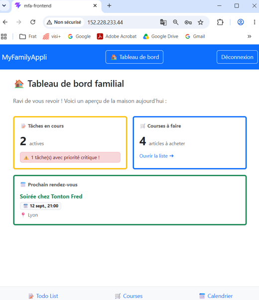
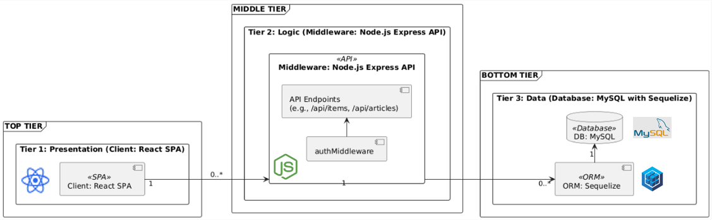

# 🏠 MyFamilyAppli — Application de gestion familiale

**Projet individuel réalisé dans le cadre de la certification RNCP n°37873 de Niveau 6 : Concepteur Développeur d'Applications**
MyFamilyAppli est une application Web (Single Page Application) conçue pour faciliter l'organisation quotidienne des familles grâce à des listes partagées et un calendrier commun.
J’ai mené la conception et le développement de l’application, de la modélisation des données à la réalisation du frontend, du backend et des tests, jusqu'au déploiement en production sur VPS Cloud.

[Présentation du projet](Presentation_MFA.pdf) · [Architecture](architecture_MFA.png) · [Retour au portfolio](../../README.md)

## Aperçu du résultat

## Besoin et périmètre

L’objectif est de proposer une interface commune pour consulter et gérer les activités quotidiennes d’une famille.

Le périmètre réalisé comprend :

- l’authentification des utilisateurs ;
- un tableau de bord ;
- la gestion des événements du calendrier ;
- la gestion des listes de tâches ;
- la gestion des articles de la liste de courses.

## Ma contribution

Projet mené individuellement :

- analyse du besoin et définition du périmètre fonctionnel ;
- conception du modèle de données et des diagrammes de l’application ;
- développement de l’API et des accès à la base de données ;
- réalisation de l’interface et de ses échanges avec le backend ;
- mise en place de l’authentification ;
- rédaction et exécution de tests backend et frontend ;
- mise en place de pipelines automatisés CI/CD sur un VPS Cloud dédié ; 
- préparation de la documentation et de la présentation du projet.

## Architecture et outils

L’interface React communique avec une API Node.js / Express. Le backend utilise Sequelize pour accéder à la base MySQL. L’authentification repose sur des jetons JWT.

| Composant | Technologies | Rôle |
| --- | --- | --- |
| Interface utilisateur | React, React Router, Bootstrap | Navigation, affichage et saisie |
| API | Node.js, Express | Traitement des requêtes et logique applicative |
| Accès aux données | Sequelize, MySQL | Persistance et relations entre les entités |
| Authentification | JWT, bcrypt | Authentification et gestion des mots de passe |
| Tests backend | Jest, Supertest | Vérification du comportement de l’API |
| Tests frontend | Vitest, React Testing Library | Vérification de composants et de comportements de l’interface |

## Modélisation et gestion des données

Le modèle relationnel s’organise autour des familles, utilisateurs, listes de tâches, tâches, événements et articles de courses.

Les relations entre ces entités traduisent les besoins fonctionnels : rattacher les utilisateurs à une famille, organiser les tâches par liste et enregistrer les informations nécessaires à leur gestion.

Ce travail permet d’examiner ma capacité à :

- traduire un besoin métier en structures de données ;
- définir les relations entre les entités ;
- développer des opérations de création, lecture, modification et suppression ;
- articuler modèle de données, API et interface utilisateur.

## Validation

Des tests ont été réalisés sur le backend avec Jest / Supertest et sur le frontend avec Vitest / React Testing Library.

Les éléments de présentation permettent de découvrir le fonctionnement de l’application. La vérification détaillée des scénarios et de leur couverture nécessite l’examen des fichiers de tests et de leurs rapports d’exécution dans le dépôt source.

## Intérêt pour le Data Engineering

MyFamilyAppli est avant tout un projet de développement applicatif et démontre des compétences transférables à des projets Data : conception relationnelle, manipulation de données persistantes, développement d’une API, séparation des responsabilités et validation par des tests.

## Documents disponibles

- [Présentation du projet au format PDF](Presentation_MFA.pdf)
- [Schéma d’architecture](architecture_MFA.png)
- [Capture du tableau de bord](dashboard_MFA.png)
- [Code source](https://github.com/ThereseNGN/my_family_appli.git)

