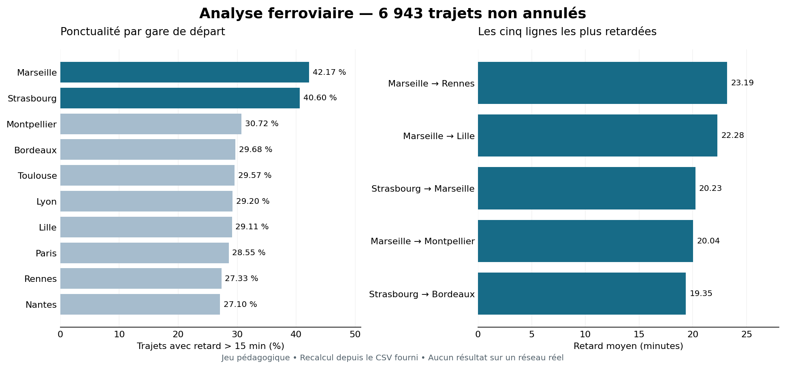
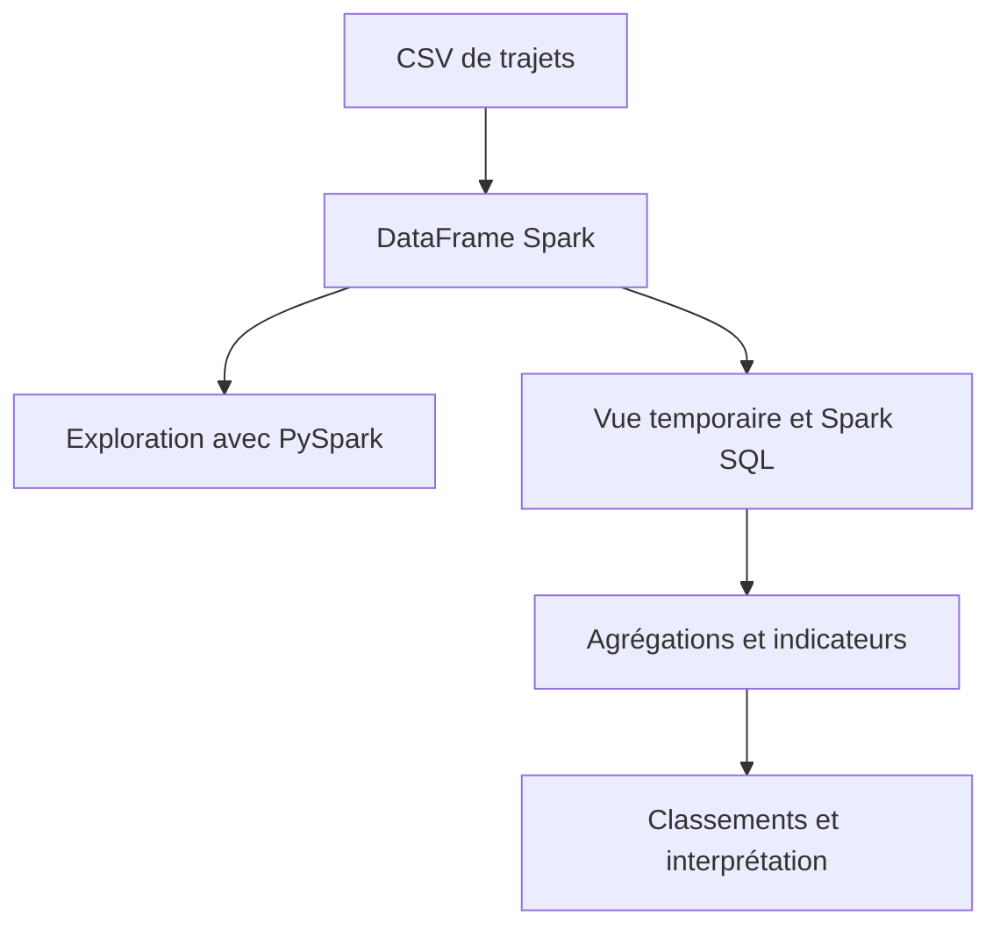

# Analyse ferroviaire avec PySpark et Spark SQL

**TP individuel évalué, réalisé dans Databricks dans le cadre de ma formation Ingénieur Data et IA.**

À partir de données de trajets ferroviaires, j’ai développé 21 exercices pour explorer le jeu de données et calculer des indicateurs de fréquentation, d’annulation et de ponctualité. J’ai utilisé l’API DataFrame PySpark pour la partie A, puis Spark SQL pour les analyses des parties B à F.

[Enoncé du TP](sources/enonce_TP.pdf) · [Voir le notebook avec les résultats](notebooks/tp-trains-compte-rendu.ipynb) · [Lire la synthèse](docs/resultats.md) · [Retour au portfolio](../../README.md)

## Résultat en un regard

| Indicateur                           |  Résultat |
| ------------------------------------ | --------: |
| Trajets dans le CSV                  |     7 200 |
| Trajets non annulés                  |     6 943 |
| Trajets annulés                      |       257 |
| Gares de départ                      |        10 |
| Lignes directionnelles               |        90 |
| Retard moyen des trajets non annulés | 14,84 min |

_Visualisation ajoutée pour le portfolio à partir du CSV fourni ; elle ne fait pas partie du rendu Databricks initial. Les valeurs correspondent aux résultats enregistrés dans le notebook._

## Besoin et démarche

Le cas pédagogique consiste à comparer l’activité et la ponctualité d’un réseau ferroviaire. Il s’agit d’identifier les gares et les lignes à examiner en priorité, tout en définissant précisément le périmètre des indicateurs.

## Ce que j’ai réalisé

| Étape                           | Réalisation                                                                              | Preuve            |
| ------------------------------- | ---------------------------------------------------------------------------------------- | ----------------- |
| Chargement et exploration       | Lecture du CSV, inférence du schéma, comptage, sélection, valeurs distinctes et filtrage | Exercices 1 à 4   |
| Préparation analytique          | Vue temporaire SQL et classification des retards avec `CASE WHEN`                        | Exercices 5 à 8   |
| Analyse des gares et lignes     | Agrégations, classements et application d’un seuil de 30 trajets                         | Exercices 9 à 14  |
| Analyse des types et compagnies | `GROUP BY`, `HAVING`, agrégations conditionnelles                                        | Exercices 15 à 18 |
| Synthèse                        | Taux de retards supérieurs à 15 minutes et rapport par ligne                             | Exercices 19 à 21 |

L’énoncé, les données et les indicateurs attendus étaient fournis. Mon travail porte sur les traitements, requêtes et interprétations consignés dans le notebook. Aucun résultat de notation n’est publié ici.

## Principaux résultats

- Strasbourg cumule le plus de passagers au départ : **246 226**, devant Lyon (**244 684**).
- Lyon → Strasbourg est la ligne la plus fréquentée : **30 115 passagers**, avec **12,17 minutes** de retard moyen.
- Marseille et Strasbourg ont les taux les plus élevés de trajets en retard de plus de 15 minutes : **42,17 %** et **40,60 %**.
- Marseille → Rennes présente le retard moyen le plus élevé : **23,19 minutes**, sur **75 trajets non annulés**.

Ces résultats décrivent le jeu pédagogique fourni. Ils ne constituent ni un diagnostic d’un réseau réel ni une démonstration des causes des retards. Le total de passagers est une somme par trajet, pas un nombre de voyageurs uniques.

## Compétences démontrées et intérêt Data Engineering

Python, PySpark DataFrame, Spark SQL, vues temporaires, filtrage, agrégations et construction d’indicateurs.

Le projet montre la capacité à transformer des données tabulaires en résultats contrôlables et à appliquer des règles métier cohérentes, notamment l’exclusion des annulations pour les indicateurs de retard.

Le TP démontre une pratique de Spark, sans revendiquer une expérience à grande échelle dû au volume pédagogique.

## Examiner le travail

1. Ouvrir le [notebook avec sorties](notebooks/tp-trains-compte-rendu.ipynb) pour vérifier le code et les résultats conservés.
2. Suivre le [guide d’exécution](docs/execution.md) pour consulter le notebook.
3. Examiner le [dictionnaire des données](data/README.md) et les [tables de résultats](resultats/).

## Documents

- [Notebook avec résultats](notebooks/tp-trains-compte-rendu.ipynb)
- [Lecture HTML autonome du compte-rendu](notebooks/lecture-resultats.html) — télécharger et ouvrir dans un navigateur
- [Données et provenance](data/README.md)
- [Résultats commentés](docs/resultats.md)

## Améliorations possibles

Ajouter un schéma explicite et des contrôles qualité à l’ingestion, exporter les agrégats depuis Spark, analyser la ponctualité par période et examiner les plans d’exécution sur un volume plus important.
